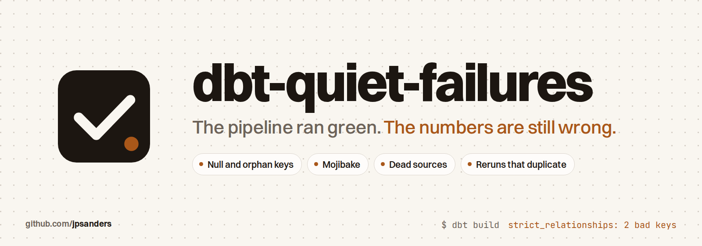

<p align="center">
  <picture>
    <source media="(prefers-color-scheme: dark)" srcset="docs/images/banner-dark.png">
    
  </picture>
</p>

<p align="center">
  <a href="https://github.com/jpsanders/dbt-quiet-failures/actions/workflows/ci.yml"></a>
  <a href="https://github.com/jpsanders/dbt-quiet-failures/releases/latest"></a>
  
  
  
  <a href="#with-an-ai-agent"></a>
  <a href="LICENSE"></a>
  <a href="https://github.com/jpsanders/dbt-quiet-failures/stargazers"></a>
</p>

Four dbt checks for the failures that pass every other test.

The pipeline ran green. The numbers are still wrong. Each check here targets one way that happens, and each is proven in CI against a fixture that contains the failure.

## Install

```yaml
# packages.yml
packages:
  - git: "https://github.com/jpsanders/dbt-quiet-failures.git"
    revision: 1.0.0
```

Then `dbt deps`. No other packages are needed. It needs dbt 1.10 or later. The checks use dbt's cross database macros, and CI runs them on DuckDB with dbt 1.10 and 1.12.

## 1. The fact table joins on a null

**Check: `strict_relationships`**

dbt's `relationships` test skips rows whose key is null. The fact row passes, then vanishes from every inner join downstream, and the revenue number comes out quietly short. Surrogate keys hide it further, because hashing a row of nulls produces an ordinary looking value that `not_null` accepts.

`strict_relationships` fails on a null key, an empty key and a key with no match in the parent. A deliberate unknown member, a key of -1 for example, passes as long as the dimension carries it.

```yaml
columns:
  - name: customer_key
    data_tests:
      - quiet_failures.strict_relationships:
          arguments:
            to: ref('dim_customer')
            field: customer_key
```

In the CI fixture there are two bad keys, one null and one orphan. dbt's own test finds one. This check finds both.

## 2. A rerun duplicates instead of repairing

**Check: `scripts/check_rerun.sh`, built on the `fingerprint` macro**

An incremental model without a reliable unique key appends the same rows again when it reruns. Nothing fails. The only proof of a safe rerun is to run the model twice and compare.

```bash
scripts/check_rerun.sh fct_orders --target ci
```

The script runs the model, logs its row count and its count of distinct rows, runs it again, and exits with an error if either number moved. In CI a keyed incremental model stays at 3 rows. An unkeyed one goes from 3 to 6, and the script catches it.

To fingerprint a model on its own:

```bash
dbt run-operation quiet_failures.fingerprint --args '{model: fct_orders}'
```

## 3. Text arrives as mojibake

**Check: `no_mojibake`**

UTF-8 read as Latin-1 or Windows-1252 turns "José" into "José" and a curly apostrophe into "’". Nothing errors, and the noise reaches a customer facing report weeks later.

`no_mojibake` fails on those byte pair signatures and on the Unicode replacement character. A lone "Ã" is not enough, so uppercase Portuguese such as "SÃO PAULO" passes.

```yaml
columns:
  - name: customer_name
    data_tests:
      - quiet_failures.no_mojibake
```

Pass `patterns` to replace the default list.

## 4. A dead source keeps building

**Check: `still_loading`**

A system is switched off, its table stops updating, and every model on top of it keeps running green against old data. `dbt source freshness` catches this, but it is a separate command that `dbt build` does not run, so it only helps where someone has scheduled it.

`still_loading` fails when the newest value in the column is older than the window you set.

```yaml
columns:
  - name: loaded_at
    data_tests:
      - quiet_failures.still_loading:
          arguments:
            datepart: hour
            interval: 24
```

`dbt_utils.recency` does the same job. This one ships with the other three so the package has no dependencies.

## Proof

`integration_tests/run.sh` seeds a fixture for each failure and asserts the exact number of rows each check returns: 2 bad keys, 2 garbled names, 1 dead source, and a rerun that doubles 3 rows to 6. It also runs every check on clean data, where each must find nothing. A check that cannot fail proves nothing.

```bash
pip install dbt-duckdb
integration_tests/run.sh
```

## With an AI agent

The repository is a Claude Code plugin with a skill that knows where each check belongs: every foreign key of a fact
model, text from other systems, each source's load timestamp, and every incremental model in CI.

```text
/plugin install dbt-quiet-failures --marketplace jpsanders/dbt-quiet-failures
```

On Claude Code before 2.1.275: `/plugin marketplace add jpsanders/dbt-quiet-failures`, then
`/plugin install dbt-quiet-failures@dbt-quiet-failures`. Then ask: "add the quiet failure checks to this dbt project".
Other agents read [`skills/dbt-quiet-failures/SKILL.md`](skills/dbt-quiet-failures/SKILL.md) as it is.

## The manual

Every check, argument and exit status in one reference: [`docs/MANUAL.md`](docs/MANUAL.md), also built as a man page.
After `dbt deps`, read it with `man -l dbt_packages/quiet_failures/man/dbt-quiet-failures.7`.

## How it was made

I found and fixed each of these failures in production dbt projects. Each time the build was green and the output was wrong. For each one I specified a check that fails on the real failure and stays quiet on clean data, and the integration suite above proves both.

Issues and pull requests are welcome; see [CONTRIBUTING.md](CONTRIBUTING.md).

## Star history

<a href="https://star-history.com/#jpsanders/dbt-quiet-failures&Date">
  <picture>
    <source media="(prefers-color-scheme: dark)" srcset="https://api.star-history.com/svg?repos=jpsanders/dbt-quiet-failures&type=Date&theme=dark">
    
  </picture>
</a>

## Licence

MIT. Made by [James Phillip Sanders](https://jamesphillipsanders.com).
